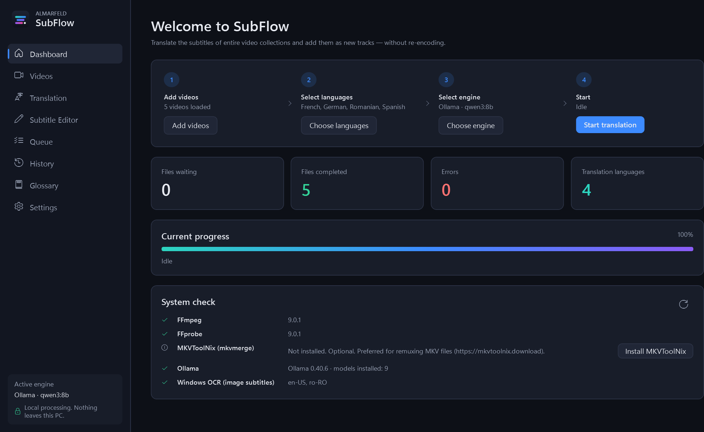
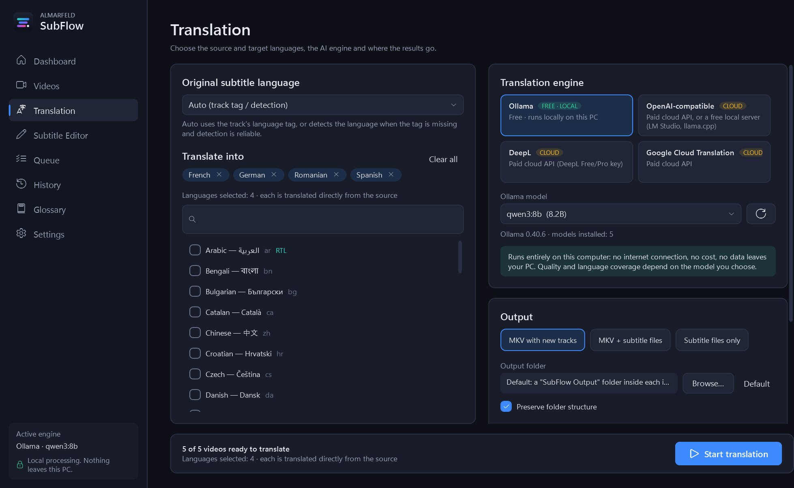
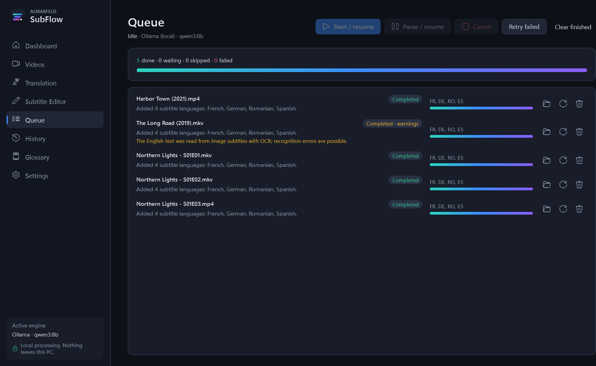
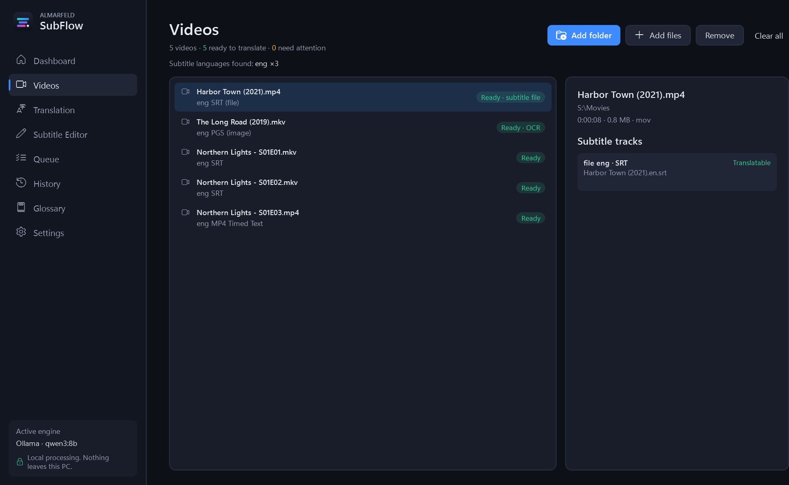
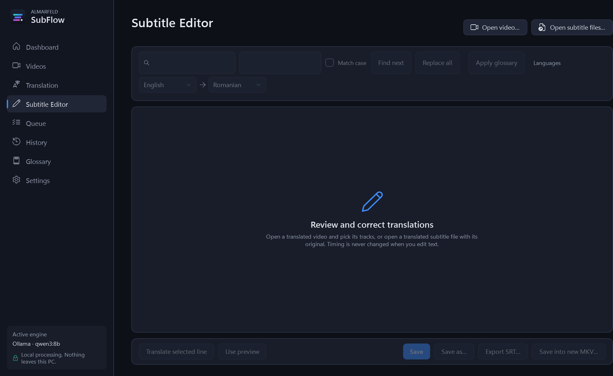
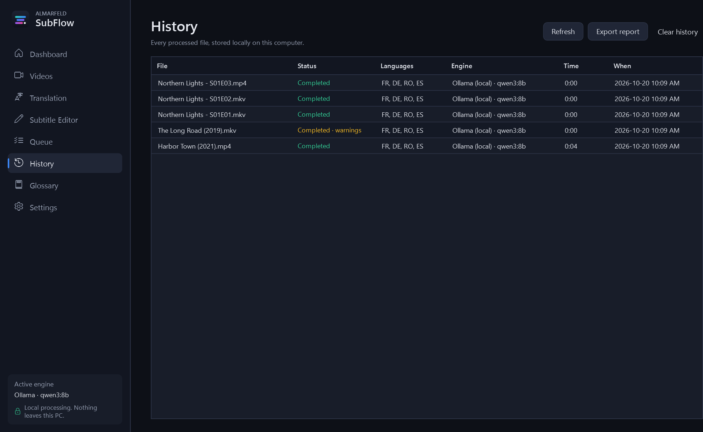
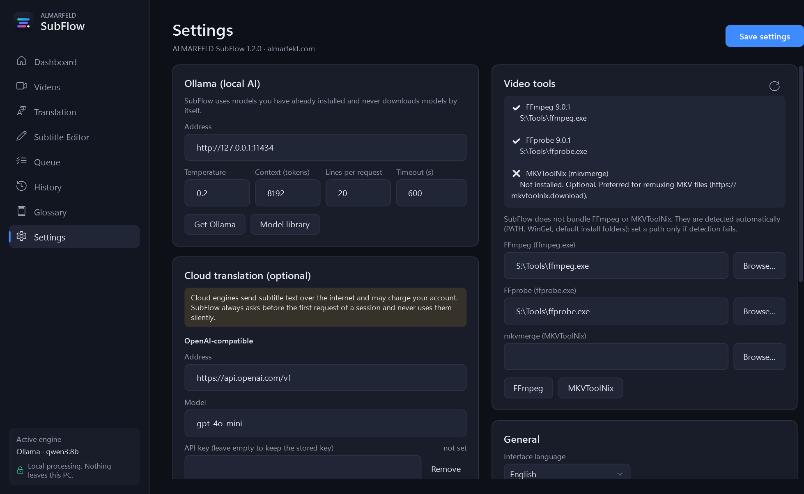
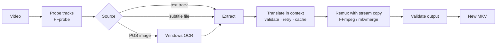

<p align="center">
  
</p>

<h1 align="center">ALMARFELD SubFlow</h1>

<p align="center">
  <b>Translate the subtitles of entire video libraries with local AI, and add them as new tracks without re-encoding.</b>
</p>

<p align="center">
  <a href="https://github.com/AlinTibi/SubFlow/releases/latest"></a>
</p>

<p align="center">
  
  
  
  
</p>

<p align="center">
  
</p>

---

Drop in a single movie, a season or a whole library of series. SubFlow:
1. finds the subtitles in each file;
2. translates them into as many languages as you like with an AI model running **on your own PC**;
3. writes a new MKV with the original video, audio and subtitles **untouched**, plus one new subtitle track per language.

Your original files are never modified.

## Why SubFlow

- 🔒 **Private by default.** Translation runs locally with [Ollama](https://ollama.com). No upload, no account and no telemetry. Cloud engines are optional and always ask before sending anything.
- 🎞️ **Lossless.** Video and audio are copied bit for bit. Output stream metadata and track counts are checked before the new MKV is saved. These checks do not certify every translated word or hash every media packet.
- 📚 **Built for collections.** It runs batches of hundreds of files, with a resumable queue, a translation cache, and a glossary that keeps names consistent across a series.
- 🧠 **Honest translation.**
  - Lines are translated in context.
  - Each answer is validated: line count, alphabet, length, untranslated text and glossary terms.
  - Answers that fail a check are retried.
  - Incomplete responses are rejected rather than silently dropping missing lines. Translation accuracy still requires human review.

## Features

| | |
|---|---|
| **Sources** | Embedded SRT, ASS/SSA, WebVTT and MP4 text tracks · subtitle files next to the video (`Movie.en.srt`) · Blu-ray **PGS image subtitles via Windows OCR** |
| **Languages** | 42 built in, including right-to-left (Arabic, Hebrew, Persian, Urdu); more can be added with a JSON file. Tracks get correct ISO 639-2 tags and titles such as "Romanian (AI)". |
| **Engines** | Ollama (local, free) · any OpenAI-compatible API, including local LM Studio or llama.cpp · DeepL · Google Cloud Translation |
| **Output** | New MKV (stream copy, chapters and attachments kept) and/or SRT/ASS/VTT files. ASS styles and line formatting are preserved. |
| **Smart track choice** | Picks the full dialogue track over "forced", "signs" or "songs" tracks, even when those are marked as default. |
| **Workflow** | Drag and drop · pause, resume, cancel and retry · history with CSV export · subtitle editor with side-by-side view and find/replace · global and per-series glossary |
| **Setup help** | The Dashboard checks FFmpeg, Ollama and OCR, and installs what is missing with one click (through winget, after you confirm). |
| **Safety** | API keys encrypted with Windows DPAPI · no shell commands · no administrator rights · no DRM circumvention |

<details>
<summary><b>More screenshots</b></summary>

| Translation | Queue |
|---|---|
|  |  |

| Videos | Subtitle editor |
|---|---|
|  |  |

| History | Settings |
|---|---|
|  |  |

</details>

## Download and install

Get the latest version from **[Releases](https://github.com/AlinTibi/SubFlow/releases/latest)**:

| File | What it is |
|---|---|
| `ALMARFELD-SubFlow-x.y.z-setup-win-x64.exe` | **Installer (recommended).** Installs for your user only, so no administrator rights are needed. Adds a Start menu entry and an uninstaller. |
| `ALMARFELD-SubFlow-x.y.z-win-x64.zip` | Portable version. Extract it anywhere and run `SubFlow.exe`. |
| `…-SHA256SUMS.txt` | Checksums to verify the downloads. |

SubFlow is a single self-contained program: you do not need to install .NET or WebView2. Windows binaries are not Authenticode signed, so Windows may show a reputation warning. Download only from the official GitHub release and verify the SHA-256 checksum; do not disable Windows security.

A new installation starts with no videos, queue entries, translation cache or history. No videos, subtitle samples or AI models are included.

### First start

The **Dashboard** checks what SubFlow needs and offers to install anything that is missing:

| Component | Needed for | How |
|---|---|---|
| **FFmpeg** | reading and remuxing videos (required) | **Install FFmpeg** button, or `winget install Gyan.FFmpeg` |
| **Ollama** and a model | free local translation | **Install Ollama**, then **Download qwen3:8b** (about 5 GB) |
| MKVToolNix | optional, best for MKV files | **Install MKVToolNix**, or `winget install MoritzBunkus.MKVToolNix` |
| Windows OCR language | optional, for PGS image subtitles | Windows Settings → Time & language → add the language |

FFmpeg, Ollama, MKVToolNix and AI models are separate projects with their own licences. They are **not bundled**, and SubFlow never downloads anything without asking you first.

**Which model?**
- `qwen3:8b` is a good default for many languages; 8 GB or more of GPU memory is recommended.
- `gemma3:4b` suits smaller GPUs.
- `qwen3:14b` or `gemma3:12b` give the best quality if you have the memory.

## How to use it

1. **Videos:** drag files or folders onto the window. Every file shows its subtitle tracks.
2. **Translation:** tick the target languages, choose the engine and model, and press **Start**.
3. **Queue:** follow the progress. You can pause, close SubFlow and resume later.
4. **Results:** they appear in a `SubFlow Output` folder next to your videos, with the same subfolders. You can also choose your own output folder.

Read the **[User guide](docs/USER_GUIDE.md)** and the **[Troubleshooting](docs/TROUBLESHOOTING.md)** guide for details.

## How it works



## Verify your download

Download `ALMARFELD-SubFlow-1.2.2-SHA256SUMS.txt` from the same official release. In PowerShell, run:

```powershell
Get-FileHash -Algorithm SHA256 .\ALMARFELD-SubFlow-1.2.2-setup-win-x64.exe
Get-FileHash -Algorithm SHA256 .\ALMARFELD-SubFlow-1.2.2-win-x64.zip
```

Compare with the corresponding published line. A matching hash checks artifact bytes; it is not a malware scan or an Authenticode signature.

## Privacy

- **Local translation:** subtitle text goes only to your Ollama server, which is `127.0.0.1` by default.
- **Cloud engines:** before the first request of a session, SubFlow tells you what will be sent and whether the provider may charge you.
- **Never sent anywhere:** video and audio.
- **Network calls:** besides your translation engine, SubFlow contacts GitHub only for the update check, which is off by default.
- **Where your data stays:** settings and glossaries are in `%APPDATA%\ALMARFELD\SubFlow`; history, the translation cache and logs are in `%LOCALAPPDATA%\ALMARFELD\SubFlow`.

## Building from source

You need Windows 10/11, the [.NET 8 SDK](https://dotnet.microsoft.com/download/dotnet/8.0) and FFmpeg on `PATH`.

```
dotnet build ALMARFELD.SubFlow.sln -c Release
dotnet test ALMARFELD.SubFlow.sln
powershell -ExecutionPolicy Bypass -File build\package.ps1
```

- **Packaging:** `package.ps1` produces the self-contained `SubFlow.exe`, the ZIP, the installer (it needs [Inno Setup 6](https://jrsoftware.org/isinfo.php)) and the checksums in `artifacts\`.
- **Tests:** the tests generate their own synthetic videos and PGS subtitles, so no copyrighted media is involved.

The project layout and the guidelines are in **[CONTRIBUTING.md](CONTRIBUTING.md)**.

## Contributing

Bug reports, ideas and pull requests are welcome; see [CONTRIBUTING.md](CONTRIBUTING.md). Please report security issues privately as described in [SECURITY.md](SECURITY.md).

## License

SubFlow is free and open source under the **[MIT License](LICENSE)**. Third-party components and their licences are listed in [THIRD-PARTY-NOTICES.md](THIRD-PARTY-NOTICES.md).

SubFlow relies on these projects: [FFmpeg](https://ffmpeg.org), [Ollama](https://ollama.com), [MKVToolNix](https://mkvtoolnix.download), [SQLite](https://sqlite.org) and the [.NET](https://dotnet.microsoft.com) platform.

<p align="center">Made by <a href="https://almarfeld.com">ALMARFELD</a></p>
